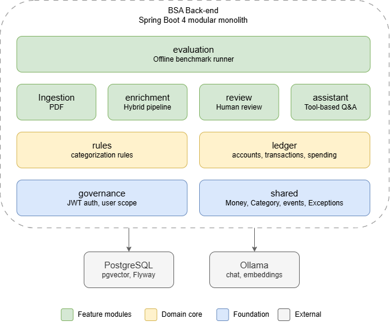
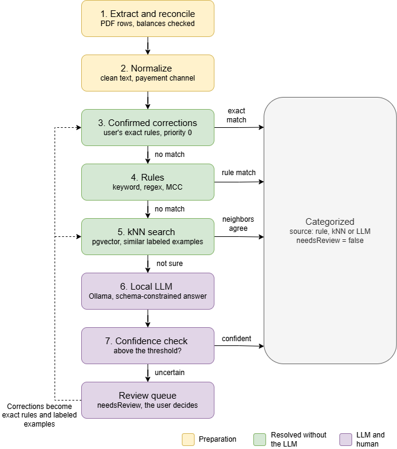
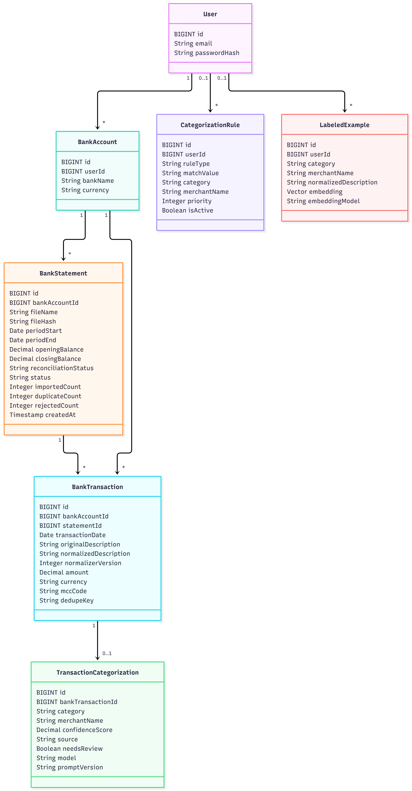

[](https://github.com/MedJaouada7/ai-bank-statement-analyzer/actions/workflows/ci.yml)


# AI Bank Statement Analyzer (BSA)


**Contents:** [Overview](#overview) · [Stack](#technology-stack) · [Key features](#key-features) · [Architecture](#architecture) · [Pipeline](#transaction-processing-pipeline) · [AI strategy](#ai--categorization-strategy) · [Evaluation](#evaluation--testing) · [Database](#database-design) · [Structure](#project-structure)


## Overview

### The problem

Bank statements are PDFs full of cryptic descriptors such as `PAIEMENT CB 1411 STARBUCKS PARIS 75002`. Rules alone struggle with unknown merchants. Calling an LLM for every line is slow and can produce wrong results. A plain "chat with your data" assistant can invent figures.

This project categorizes only what it can justify, sends uncertain cases to a human, and keeps every number deterministic. It is built around one idea: AI is used where it adds measurable value, and ordinary code is used everywhere else.

### Highlights

- Extracts transactions from PDF statements and checks them against the statement's own balances.
- Categorizes with a hybrid pipeline: rules, pgvector similarity search, then a local LLM.
- Routes uncertain predictions to a review queue, and learns from the corrections.
- Answers spending questions through validated tools, not by reading a database dump.
- Evaluates the pipeline on a labeled dataset with documented methodology and limits.

### Project status

**In development.** Updated as the work progresses.

| Area | State |
|---|---|
| Project skeleton, module boundaries, architecture tests, Flyway, test infrastructure | Done |
| Early spikes (local LLM, Spring AI structured output, PDF text extraction) | Done |
| Category taxonomy, labeled evaluation dataset (360 items), synthetic statement generator | Done |
| PDF ingestion, extraction and normalization | In progress |
| Rules, kNN and LLM categorization pipeline, review queue | Planned |
| Evaluation runner and results | Planned |
| Conversational assistant | Planned |
| Authentication | Planned |
| Front-end (User interface and Dashboard) | Low priority |


## Technology stack

| Category | Technologies |
|---|---|
| Backend | Java 25, Spring Boot 4, Spring Web MVC, springdoc OpenAPI |
| AI | Spring AI, Ollama (`llama3.2:3b-instruct-q4_K_M`) |
| Vector search | PostgreSQL, pgvector (`nomic-embed-text:v1.5`) |
| Database | Spring Data JPA, JdbcClient, Flyway |
| Document parsing | Apache PDFBox |
| Architecture | Spring Modulith, ArchUnit |
| Infrastructure | Docker Compose |
| CI/CD | GitHub Actions |
| Testing and quality | JUnit 5, Testcontainers, WireMock, JaCoCo, Spotless |
| Tooling | Python (synthetic statement generator) |


## Key features

| Feature | What it does |
|---|---|
| **PDF ingestion and extraction** | Reads text-based PDF statements, rebuilds rows from word positions, and verifies that opening balance + credits − debits = closing balance. Re-imports never create duplicates. |
| **Hybrid categorization** | Assigns one of 19 categories with cheap, explainable methods first and a local LLM only when needed (see [Pipeline](#transaction-processing-pipeline)). |
| **Manual review** | Uncertain results go to a review queue ordered by amount, and corrections improve future predictions. |
| **Conversational assistant** | Questions such as "how much did I spend on dining in March?" are answered from deterministic backend queries. |

## Architecture



The application is a **modular monolith**: one deployable, with boundaries enforced by tests.

In the diagram, we distinguish three layers:
- **Feature modules (green):** the workflows a user triggers. They are import (ingestion), categorize (enrichment), review, and ask questions (assistant). They never call each other and communicate through events. evaluation sits on top as the offline runner.
- **Domain core (yellow):** ledger and rules, the business data and logic that the features share. Features depend on the core, and the core doesn't know the features exist.
- **Foundation (blue):** governance and shared, which everything may use.
- **External (gray)** 

NB: Arrows are omitted for readability. Each layer may depend only on layers below it. The four feature modules (ingestion, enrichment, review, assistant) never call each other and communicate through events.

| Module | Responsibility |
|---|---|
| `ingestion` | Reads PDF files, parses amounts and dates, reconciles balances, rejects bad rows. |
| `ledger` | Source of truth for financial data (accounts, statements, transactions, categorizations) and the spending queries built on it. |
| `enrichment` | Normalizer and the categorization pipeline (see [Pipeline](#transaction-processing-pipeline)). |
| `rules` | Global and user categorization rules, and their matching logic. |
| `review` | Review queue and user corrections. |
| `assistant` | Intent handling, validated tools, answer checks, and guardrails. |
| `evaluation` | Dataset validation, benchmark runner, metrics, and reports. |
| `governance` | Authentication, current-user scoping, and log redaction. |
| `shared` | Shared types (money, categories, events) and exceptions. |
| `config` | Application wiring (RFC 7807 error handling, OpenAPI, threading). |

**Spring Modulith** checks module dependencies (`verify()`), and **ArchUnit** keeps domain code free of framework imports.

**Hexagonal architecture** (domain, ports, adapters) is used in each module where isolating a technology pays off, such as the LLM, PDF parsing, and vector search.

**Technology choices:** PostgreSQL stores relational data and vectors, so there is one database to run. Ollama runs the LLM locally, which keeps financial data on the machine and costs nothing. Flyway owns the schema. Testcontainers and a WireMock stub of Ollama let CI run without a live model.


## Transaction processing pipeline



Each transaction goes through these steps and stops at the first one that is confident enough:

1. **Ingestion and extraction.** Rebuilds rows from PDF text positions and reconciles the statement's balances. A mismatch flags the statement.
2. **Normalization.** Removes noise (prefixes, card masks, dates, store numbers, cities) and extracts the payment channel. The original description is kept.
3. **Confirmed corrections.** Exact match on the user's earlier corrections (`EXACT` rules with the highest priority).
4. **Rule-based categorization.** Global keyword, regex, and MCC rules, with sign checks (for example, salary only on credits).
5. **kNN similarity search.** Compares the description with labeled examples in pgvector and accepts the category if the nearest neighbors agree ([details](#embeddings-and-pgvector)).
6. **LLM categorization.** A local model answers with one valid category, using the retrieved examples ([details](#handling-ambiguous-transactions-with-the-llm)).
7. **Confidence evaluation and manual review.** Uncertain results are marked `needsReview`. A correction creates an `EXACT` rule and a labeled example ([details](#confidence-and-human-review)).

### How the stages complement each other

| Stage | Strength | Limit | Cost |
|---|---|---|---|
| Corrections and rules | Exact, explainable, instant | Only known patterns | Negligible |
| kNN | Handles near-duplicates and new branches of known merchants, with no generation | Needs good labeled examples | One embedding and one SQL query |
| Local LLM | Can classify merchants it has never seen | Slower (about 1.2 s per call on the development machine) and sometimes wrong | Highest |
| Human review | Final authority, and corrections improve the earlier stages | Manual effort | Human time |

Cheap, explainable stages go first, so the expensive and uncertain one runs rarely. The share of transactions that reach the LLM is a metric in the evaluation.


## AI & categorization strategy

### The local LLM, and why it is small

The development machine has 8 GB of RAM and no usable GPU, which rules out 7 to 8B models. `llama3.2:3b-instruct-q4_K_M` (about 2 GB) is the largest model that runs comfortably next to PostgreSQL, the JVM, and an IDE. I treated that limit as a design constraint: the pipeline must work well even when the model is weak. The same benchmark will later be run with a larger local model on better hardware, to measure what the small model costs in accuracy.

### Embeddings and pgvector

An embedding model (`nomic-embed-text:v1.5`) turns a normalized description into a 768-dimension vector. Descriptions with similar wording land close together, so `STARBUCKS PARIS` and `STARBUCKS LYON` are neighbors. Normalizing first matters, because store numbers and cities would otherwise dominate the vector.

### Handling ambiguous transactions with the LLM

- The prompt contains the category definitions, the retrieved examples as chat turns, the payment channel, and the normalized description.
- Spring AI's native structured output sends a JSON schema whose category field is an enum, so the model can only return a valid category.
- Temperature is 0 with a fixed seed, so runs are reproducible.
- Genuinely ambiguous cases, such as a merchant that is both a fuel station and an energy supplier, are helped by the payment channel (card at a station versus SEPA direct debit).

### Confidence and human review

A small model's self-reported confidence is poorly calibrated, so confidence comes from the pipeline: rules and exact corrections count as certain, kNN depends on similarity and neighbor agreement, and an LLM answer is more trusted when it agrees with the kNN vote. A threshold decides between auto-accept and review.

### Conversational assistant

The assistant is not an LLM that receives a database dump and writes an answer:

```
question
  → LLM interprets the intent and picks a tool, with structured arguments
  → Java validates the arguments and scopes the call to the signed-in user
  → a deterministic service retrieves transactions and computes the figures (BigDecimal, SQL)
  → the LLM turns the tool result into a readable answer
```

- The tools are read-only and allowlisted (spending summary, transaction list, recurring payments, period comparison).
- Out-of-scope questions get "I can't answer that from your transactions", and investment-advice requests are declined.
- Small local models are unreliable at open-ended tool calling, so the design keeps the tool set small and validated, with a structured-output fallback.


## Evaluation & testing

### Dataset

`eval/datasets/v1` holds **360 labeled transactions** in JSONL: **60 seed, 100 validation, and 200 test** items. Each item has a merchant group, raw description, signed amount, currency, the expected category and merchant, and optional tags (`ambiguous`, `injection`). Descriptors follow French and US bank styles and are synthetic or hand-written. A Python generator (`tools/synthetic_statements`) also produces fake statements (pdf) with ground truth (json) for testing extraction.

**Why not real statements?** They contain personal financial data and cannot be published.

### Separating evaluation data from categorization data

- **Seed** is the only data that may be used as kNN examples or few-shot examples.
- **Validation** is used to tune thresholds and prompts.
- **Test** is frozen and run once per configuration.
- Items are split by **merchant group**, so validation and test never share a merchant. Test items that share a merchant with the seed are reported separately as "seen merchants" and the others as "unseen merchants".
- A dataset validator enforces these rules (unique ids, valid categories, sign matching category, no merchant overlap).

**Compared on the same test set:** rules only, kNN only, LLM only, and the full hybrid; zero-shot vs retrieved few-shot examples; the 3B model vs a larger local model.

### Metrics

| Metric | Why |
|---|---|
| Accuracy | Overall correctness |
| Macro-F1 | Counts all 19 categories equally, so rare categories matter |
| Precision and recall per class, confusion matrix | Show which categories get mixed up |
| LLM-call rate and latency per stage | The cost of each approach |


### Results and limitations

**Results:** no benchmarks are done yet.

Early exploratory findings from spikes are in [`docs/spikes.md`](docs/spikes.md), [`docs/spike2.md`](docs/spike2.md), and [`docs/spike3.md`](docs/spike3.md). They used 19 development cases, which were also used to write prompts, so they are not a held-out measurement.


### Automated tests and quality checks

- JUnit 5 unit tests for the normalizer, amount and date parsers.
- Integration tests on PostgreSQL with pgvector through Testcontainers.
- A WireMock stub of Ollama, so CI never needs a live model.
- Spring Modulith `verify()` and ArchUnit tests for module and layer rules.
- Taxonomy parity test (enum versus `taxonomy-v1.yml`).
- JaCoCo coverage report, Spotless formatting check, and GitHub Actions running `./mvnw verify` on every push.

## Database design



All primary and foreign keys are `BIGINT` identity columns. Full attribute descriptions are in [`docs/database-tables.md`](docs/database-tables.md).

### Main classes

| Class | Purpose |
|---|---|
| `User` | Registered user: email and password hash. |
| `BankAccount` | An account owned by a user. All financial data is scoped through it. |
| `BankStatement` | One import (PDF): file hash, period, balances, reconciliation result, and counts. |
| `BankTransaction` | One extracted transaction: original and normalized description, signed amount, and a dedupe key. |
| `TransactionCategorization` | Current result: category, merchant name, confidence, source (`RULE`, `KNN`, `LLM`, `MANUAL`), `needsReview`, and the model and prompt version. |
| `CategorizationRule` | Global or per-user rule (`MCC`, `KEYWORD`, `REGEX`, `EXACT`). User corrections are `EXACT` rules with priority 0. |
| `LabeledExample` | Labeled description with its embedding, used by kNN and as few-shot examples. |

Key rules:

- Amounts are signed, negative for debits.
- Categories are not a table. They come from `taxonomy-v1.yml` and the `Category` enum.
- A transaction is unique per account through its dedupe key.
- Deleting a user cascades to all of their data.

### PostgreSQL and pgvector

One PostgreSQL database holds relational data and vectors. `LabeledExample.embedding` is a `VECTOR(768)` column with an HNSW cosine index.

### Flyway migrations

Versioned migrations in `src/main/resources/db/migration` own the schema (`V001` enables the `vector` extension). The Testcontainers database uses the same pgvector image as `compose.yaml`, so migrations are tested on every build.

---

## Project structure

```
ai-bank-statement-analyzer/
├── src/main/java/com/medj/ai_bank_statement_analyzer/
│   ├── shared/            # money types, Category enum, domain events
│   ├── config/            # wiring: RFC 7807 error handling, OpenAPI, threading
│   ├── governance/        # authentication, current user, log redaction
│   ├── rules/             # categorization rules
│   ├── ledger/            # accounts, statements, transactions, spending analytics
│   ├── ingestion/         # PDF parsing, reconciliation
│   ├── enrichment/        # normalizer and categorization pipeline
│   ├── review/            # review queue and corrections
│   ├── assistant/         # tool-based question answering
│   └── evaluation/        # dataset validation, benchmark runner, metrics
├── src/main/resources/
│   ├── db/migration/      # Flyway migrations
│   ├── taxonomy/          # taxonomy-v1.yml: 19 categories with definitions
│   └── application*.yaml  # base configuration and local / demo / eval profiles
├── src/test/              # unit, Testcontainers integration, architecture tests
├── eval/
│   ├── datasets/v1/   # seed, validation and test sets (JSONL) and manifest
│   └── configs/, runs/         # benchmark configurations and raw results
├── tools/
│   ├── synthetic_statements/   # Python generator of fake statements and ground truth
│   └── spikes/                 # exploratory scripts (Ollama classification)
├── docs/                  # spike reports, diagrams
├── scripts/               # pre-commit checks for secrets and personal data
├── compose.yaml           # PostgreSQL with pgvector (Ollama as an optional profile)
└── .github/workflows/     # CI
```

Inside each module, code follows the same layout where it helps:

- `domain/` holds pure business logic with no framework imports.
- `application/` holds use cases and the ports they depend on.
- `adapter/in` holds web and event entry points, and `adapter/out` holds persistence, LLM, and file parsing.

Only the module's root package is its public API. Sub-packages are internal.
